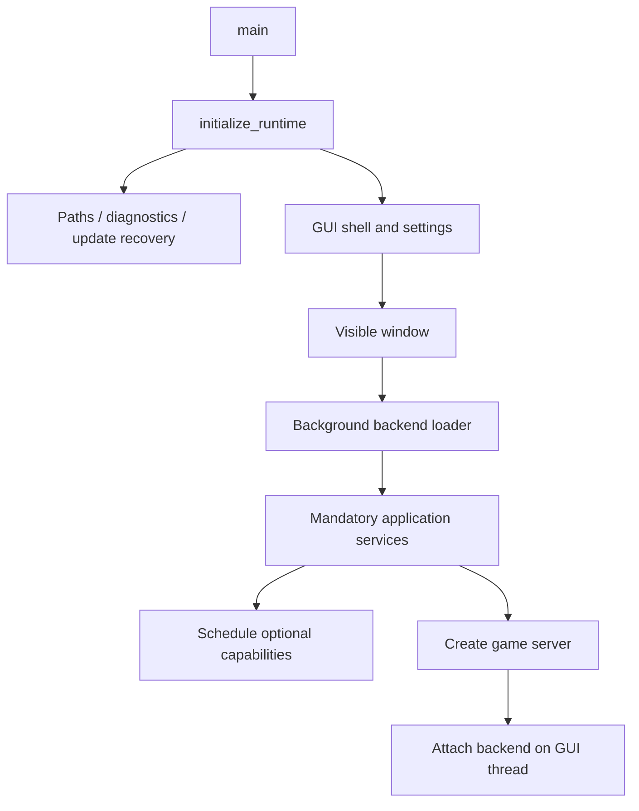

# Точки входа и первый граф достижимости

Источники и ревизии: [индекс](source-evidence-index.md), [карта](repository-map.md).

## Запуск поставляемого приложения

`scripts/run.py:816 main` проверяет `.pyz` и requirements, обеспечивает готовность Python core dependencies, задаёт изолированные пути, запускает встроенный Python с `-S` и `.pyz`. Код выхода 42 означает повторную проверку зависимостей и новый запуск. Полная семантика остальных кодов, transactional install и Launcher.exe ещё не разобрана.

`launch.py:54` — локальный путь: `build.py` → встроенный Python output-директории → поставляемый `run.py`. Комментарий называет файл ignored, но `git ls-files launch.py` подтверждает, что он tracked. Сам build.py ещё не исследован.

`src/__init__.py` добавляет `src` в sys.path для совместимого запуска flat-layout modules. `src/__main__.py:330 main` выполняет freeze_support, разбирает mode, инициализирует runtime и выбирает GUI либо headless host. Отдельный служебный аргумент `--internal-compile-fish-speech` вызывает compile helper до обычного bootstrap; inference/compiler path пока не исследован.

## Граф full

У optional capabilities нет общего барьера, который делает их все READY до серверного запуска. Это важно при описании доступности голоса, embeddings и capture.

## Различия режимов

| Режим | GUI | Backend | Сеть Unity | Особенности |
|---|---|---|---|---|
| full | Да, раньше backend | Обязательные сервисы + optional | Создаётся сервер | Backend attach через queued Qt signal |
| gui_only | Да | Shell/fallback, без основного dialogue runtime | Disconnected service | Настройки/API presets доступны отдельно |
| headless | Нет, QApplication не импортируется через host | Обязательные сервисы + optional | Сервер обязателен для успешного старта | Сигналы, ограниченная длительность, status snapshots |

Условия и ошибки подробно: [startup-and-shutdown](../03-runtime/startup-and-shutdown.md).
