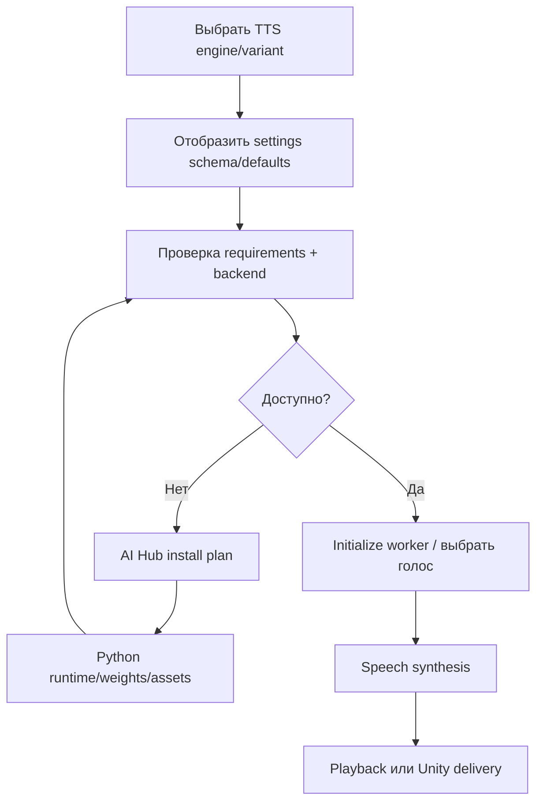

# ASR и TTS: управляемые backend-контракты установки и активации

**Цель:** фиксировать функциональное взаимодействие двух уровней — установки нужных runtime/weights и последующего запуска AI worker, а не портировать inference из Python. **Статус:** `CONDITIONAL` по выбранной модели, конфигурации устройства и наличию артефактов. **База:** `CodeNow.zip`, статический аудит.

## CAP-AI-MODEL-001 — пять ASR implementations, общая модель управления

Действующий реестр `src/handlers/asr_models/registry.py:8-51` имеет пять ID: `google`, `gigaam`, `gigaam_onnx`, `whisper`, `whisper_onnx`. Динамический import при выборе конкретного ID нужен, чтобы перечисление моделей не загружало все inference зависимости сразу. Статический label модели, backend requirement, installed status и доступность модели через worker — отдельные факты.

Общая база `src/handlers/asr_models/speech_recognizer_base.py:68-124,126-175,177-275` реализует:

1. Данные карточки из `get_model_configs()` и (при необходимости) engine-specific settings.
2. В `status(ctx)` подставляет runtime paths управляемого optional environment, если проверка идёт в GUI без `python_paths`, и только затем применяет engine settings, определяет required backend и проверяет `is_installed`.
3. В `build_install_plan(ctx)` готовая модель без `clean` возвращает `already_installed`; иначе план объединяет `pip_install_steps`, загрузку файлов из `install_manifest` **либо** asynchronous `install()`, и финальный `is_installed` probe.
4. При отдельном запуске recognizer должен инициализироваться; установленный пакет не означает «живое распознавание сейчас запущено». События AI worker capture/text/status являются отдельным runtime-контрактом (`src/handlers/asr_handler.py:61-105`).

| ASR ID | Выбранный backend в коде | Отличающие установки и проверки | Источник |
|---|---|---|---|
| `google` | CPU | `SpeechRecognition`, `sounddevice`, `silero-vad`; `is_installed` проверяет requirements, online speech recognition зависит от внешнего сервиса | `google_recognizer.py:65-105` |
| `gigaam` | предпочтительный PyTorch backend данного устройства | hydra/omegaconf/sentencepiece и VAD; model selection + checkpoint file manifest; проверка пакетов и факта весов | `gigaam_recognizer.py:164-249` |
| `gigaam_onnx` | ONNX | ONNX runtime и GigaAM dependencies; checkpoint/ONNX assets из манифеста; requirements status | `gigaam_onnx_recognizer.py:145-225` |
| `whisper` | предпочтительный PyTorch backend | VAD, sounddevice, faster-whisper; проверка пакетов и веса, не только import | `whisper_recognizer.py:179-328` |
| `whisper_onnx` | ONNX | VAD, sounddevice, transformers/optimum; ONNX-экспортированные файлы Whisper | `whisper_onnx_recognizer.py:139-231` |

**Внимание к смыслу `required_backend`:** CPU, CUDA и ONNX — runtime families, а не отдельные пользовательские способности распознавания. `gigaam` и `whisper` выбирают `preferred_torch_kind`, ONNX-реализации используют `BackendKind.ONNX`. Качество, latency и фактическая поддержка конкретного GPU в данном проходе не бенчмаркнуты.

## CAP-AI-MODEL-002 — voice engine с несколькими model variants

`src/handlers/voice_models/base_model.py:142-185,187-300` задаёт отдельные функции: получение конфигурации модели, human-facing settings schema/defaults, `required_backend_for_model`, `requirements`, `is_model_installed`, plans, `initialize`, `voiceover`. Это не означает, что новый Rust Core должен повторить Python base class; это функциональный каталог разных операций.

**Подтверждённые семейства:** Edge/Silero + RVC CUDA/ONNX (`edge_tts_rvc_model.py:346-1245`), F5/CLF5 variants (`f5_tts_model.py:79-459,619-853`), Fish Speech variants/optional compile (`fish_speech_model.py:47-520,670-852`) и OmniVoice (`omnivoice_model.py:40-417`). Подробные параметры variants описаны в [installable component plans](installer-component-plans.md) и [локальном GUI управления озвучкой](../02-ui/local-voice-model-management-and-compile-dialogs.md).

Типовой пользовательский сценарий:

Реальная проверка TTS component status (`base_model.py:240-267`) использует requirements или fallback `is_model_installed`, плюс required backend и `needs_reinstall`. Состояние `initialized/initialized_for` сбрасывается отдельно от списка установленных файлов (`base_model.py:296-299`). Схема настроек должна приниматься и валидироваться моделью, а не складываться как произвольные unchecked GUI-строки (`base_model.py:278-294`).

**Важно:** voice engine installation, его model weights, отдельные voice bundles конкретных персонажей (`voices:all` / `voices:<character>`) и media backend FFmpeg — разные зависимости и разные owner lifecycles. Отсутствие voice assets не означает, что базовый TTS inference не установлен. Подтверждение пользователя и открытие AI Hub из voice settings — отдельный UI path.

## CAP-AI-MODEL-003 — model readiness как функциональное состояние

`not_installed/installed/ready/failed/needs_reinstall/backend_missing` — не синонимы `worker running`. Installed может определяться по requirements или файлам; ready — по этому же status плюс backend; initialize — отдельный путь. Пользователь может увидеть availability в карточке AI Hub, затем запросить реальную активацию и получить ошибку runtime модели. Нужно сохранять наблюдаемые переходы и возможность повторить активацию после изменения runtime configuration.

### Функциональные требования

- `REQ-AI-MODEL-001`: ASR IDs и вариации engines перечисляются без обязательной загрузки всех inference imports в GUI/Core.
- `REQ-AI-MODEL-002`: установки управляемых сред и весов отделены от runtime initialize/start/stop.
- `REQ-AI-MODEL-003`: в AI Hub user flow доступны progress, cancel, status, error, retry по отдельным компонентам; UI получает итоговые state projections.
- `REQ-AI-MODEL-004`: model-specific settings schema, defaults, validation и device/backend requirements не теряются при переносе core.
- `REQ-AI-MODEL-005`: Python AI Engine остаётся владельцем ASR/TTS inference; новый core контролирует выбор, запуск, устройства, доставку аудио и окружения.

### Границы уверенности

Доказаны ID, class registration, статические планы/status paths и orchestration. Не выполнялись model download, microphone/GPU test, voice synthesis, HTTP Google recognizer, Windows runtime E2E. Подробная точность `is_installed` каждой конкретной модели и compiled-cache semantics требуют специализированной проверки, но **не** поиска багов ради багов.

Связанные материалы: [speech-input.md](speech-input.md), [voice-output.md](voice-output.md), [installable-component-probe-and-operation-contracts.md](installable-component-probe-and-operation-contracts.md), [ai-ipc.md](../03-runtime/ai-ipc.md).
