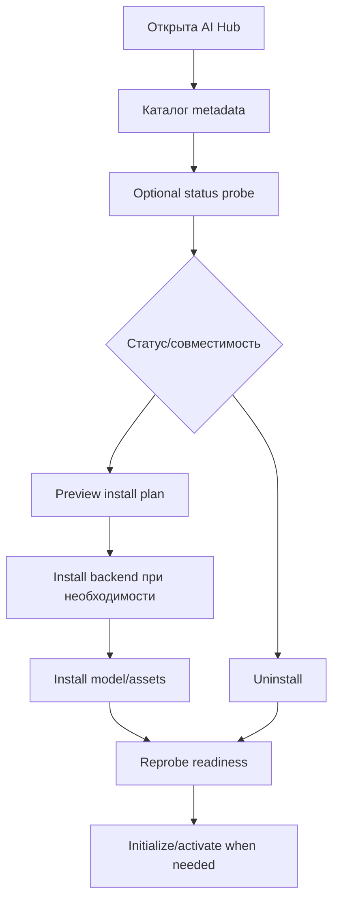

# Каталог AI-компонентов: функциональная матрица доступности и готовности

**Статус:** `ACTIVE` (каталог AI Hub и управление установкой), компоненты `CONDITIONAL` по конфигурации/оборудованию. **Источник:** snapshot Python `CodeNow.zip`, локальные `src/installables/catalog_manifest.py:42-905,908-1059`, `src/installables/registry_builder.py:13-155`, `src/core/installables/types.py:11-200`, `src/services/installable_catalog_service.py:28-868`. Это аудит *реализованных возможностей*, а не анализ дефектов и не предложение структуры Rust modules.

## 1. Что пользователь может делать

AI Hub показывает локализованную карточку компонента до импорта его реализации, может запросить readiness/status и сведения о GPU, открыть настройки, просмотреть план и дополнительные backend requirements, установить, удалить, инициализировать и обновить отображение статуса. Активация отдельных локальных voice models, ASR и RAG остаётся отдельным шагом после установки. `list_rows(include_status=False)` гарантирует доступность metadata без полноценной проверки python AI/моделей; `include_status=True` инициирует status probes (`installable_catalog_service.py:206-316`).

**Стабильная идентичность компонента** — строка `category:item_id`, но `item_id` сам по себе не уникален вне категории. Контракт `ComponentMetadata` включает category/backend/tags/languages/size/compatibility, `ComponentStatus` отдельно содержит `code`, `installed`, `ready`, `backend_ok`, `details` (`core/installables/types.py:106-157`). Успешно импортировать класс, обнаружить файлы, иметь подходящий backend и действительно быть готовым к inference — разные вопросы.

## 2. Реестр статически объявленных capability families

| Семейство | ID из каталога | Функциональное назначение | Фабрика |
|---|---|---|---|
| Backend CPU | `backend:cpu` | управляемый runtime для CPU-моделей | `core.backends.installable_component` |
| Backend CUDA | `backend:cuda` | runtime PyTorch CUDA | там же |
| Backend ONNX | `backend:onnx` | runtime ONNX/DirectML/CPU | там же |
| Edge/Silero + RVC CUDA | `tts:edge_tts_rvc_cuda`, `tts:silero_rvc_cuda` | речь + voice conversion на CUDA | `handlers.voice_models.edge_tts_rvc_model` |
| Edge/Silero + RVC ONNX | `tts:edge_tts_rvc_onnx`, `tts:silero_rvc_onnx` | речь + RVC на ONNX | тот же module, другая фабрика |
| OmniVoice | `tts:omnivoice` | локальная voice generation | `handlers.voice_models.omnivoice_model` |
| Fish Speech | `tts:medium`, `tts:medium+`, `tts:medium+low` | local speech, в т.ч. варианты compiled/low-memory | `handlers.voice_models.fish_speech_model` |
| F5/CLF5 | `tts:high`, `tts:high_clf5`, `tts:high+low`, `tts:high_clf5+low` | локальная речь, разные pipeline/build варианты | `handlers.voice_models.f5_tts_model` |
| ASR | `asr:google`, `asr:gigaam`, `asr:gigaam_onnx`, `asr:whisper`, `asr:whisper_onnx` | распознавание голоса, cloud/local | `handlers.asr_handler` и ASR registry |
| Beat analysis | `beats:beat_this` | установка Beat This для синхронизации музыки | `game_connections.services.beat_install` |
| Codec/media prerequisites | `dependency:ffmpeg`, `dependency:opencv` | сторонние вспомогательные runtime tools | `installables.ffmpeg_component`, `installables.opencv_component` |
| Voice assets | `voices:all`, `voices:CrazyMita`, `voices:MitaKind`, `voices:CappieMita`, `voices:Mila`, `voices:ShorthairMita`, `voices:SleepyMita`, `voices:GhostMita` | скачивание голосовых данных всех/отдельных персонажей | `installables.voice_assets` |
| RAG preset models | динамические `rag:<model-id>` из preset catalog | embedding / reranker конкретной модели | `managers.rag.install_spec` |
| RAG aggregate lookup | `rag:embeddings`, `rag:reranker` | установка активной, в т.ч. custom модели из settings | тот же module; скрыты из общей grid |
| Active custom RAG | динамические `rag:<id>` | карточки для custom models, которых нет в preset catalog | тот же module |

Статические ID подтверждаются `catalog_manifest.py:43-904`. RAG family не исчерпывается статическим списком: пресеты загружаются из `all_model_specs`; custom активные — из `custom_active_model_specs`, при чтении каталога; агрегаты доступны lookup-ом, но не отображаются в сетке (`catalog_manifest.py:905-1059`). Поэтому фиксированный список RAG-карточек при переписывании потеряет возможность установки пользовательской активной модели.

## 3. Lifecycle и состояния

1. Каталог использует двухфазную загрузку: метаданные импортируются при старте GUI shell, target implementation поднимается по запросу status/settings/action. Фабрики сгруппированы по loader path; первый импорт группы обслуживает остальные ID той же группы. Ошибка loader запоминается до `invalidate`/refresh (`registry_builder.py:13-155`).
2. Compatibility вычисляется независимо от installed state на основании backend kind, hardware vendor, CUDA compute capability и дополнительных rules. `supported=false` препятствует запуску install, а `recommended=false` само по себе является советом; NVIDIA ONNX/DirectML считается доступным, но не рекомендованным при предпочтительности CUDA (`core/installables/compatibility.py:9-169`, `installable_catalog_service.py:179-195`). Метаданные compatibility должны быть идентичны в RU/EN (`catalog_manifest.py:24-40`).
3. `install_preview` собирает необходимый `required_backend`, проверяет backend readiness, дополнительные компоненты, список install actions и информацию о GPU (`installable_catalog_service.py:371-454`). Это **preview**, не гарантия результата загрузки.
4. `build_operation_plan` поддерживает `install`, `uninstall`, `initialize`; явно разрешённые ключи execution context передаются фабрике. При отсутствии initialize plan возвращается no-op plan (`installable_catalog_service.py:456-513`).
5. После установки/изменения настроек инвалидируются и catalog status, и lazy registry. Settings schema может предоставляться самим компонентом; проверяются поведения полей, device compatibility, component validation, затем сохранение и инвалидирование статуса (`installable_catalog_service.py:514-614`).
6. Для status проверок предусмотрены cached snapshots по `component_id/context_fingerprint`, четыре потока probe, дедупликация inflight и timeout ответа интерфейсу с последующей возможной доставкой результата; изменение ревизии исключает использование устаревшей проверки (`installable_catalog_service.py:616-868`). Это **два результата на разных временны́х горизонтах**, а не один synchronous getter.

## 4. Контракт готовности

`ComponentStatusCode` поддерживает: `unknown`, `not_installed`, `installed`, `ready`, `needs_reinstall`, `backend_missing`, `failed` (`core/installables/types.py:21-29`). Поле `installed` описывает состояние installation artifacts, поле `ready` — возможность использования, `backend_ok` — готовность критической среды. Статус с `code=installed` не должен автоматически означать, что модель уже инициализирована для генерации.

Сама проверка конкретного компонента принадлежит его implementation: `handlers.voice_models.*`, `handlers.asr_models.*`, `managers.rag.install_spec`, `game_connections.services.beat_install`, `installables.*`. Локальные TTS и ASR могут потребовать отдельного Python AI environment, weights, backend artifacts, GPU restrictions. Дополнительные планы — в `installer-component-plans.md`, `asr-rag-beat-install-plans.md`, `installable-catalog-lazy-registry-and-status.md` и `03-runtime/installer-recovery-and-uninstall.md`. Настоящий проход не запускал inference и не считывал readiness на реальной машине пользователя.

## 5. Выводы для функционального паритета Rust Core

- Нужны перечислимые категории AI/asset/runtime components, локализованные карточки, отдельные статусы и installation plans. AI inference при этом **остаётся в Python workers**; catalog management не переносит модели на Rust.
- Не объединять `installed`, `ready`, `initialized`, `compatible`, `recommended`, `verified by actual synthesis/recognition` в одно Boolean состояние.
- Нужны dynamic RAG records, explicit component/category identifiers, refresh/invalidate after environment/settings changes, cancellation и bounded status requests.
- Потребители GUI должны получать status/progress/errors без зависимости от того, что heavy inference implementation можно импортировать в GUI process.
- В validation fixtures необходимы: preload metadata без импорта реализации, runtime status/probe timeout, RAG custom model appearance, backend requirement preview, incompatible-vs-not-recommended hardware, settings modification invalidation, uninstall/initialize modes, restart recovery.

**Пробелы:** end-to-end install с сетью и GPU; фактическая модельная готовность после restart; точная таблица файлов и probe predicates каждого из 32+ компонентов. Эти тесты и component specifics за пределами статического каталога. **Уверенность:** CONFIRMED для вышеуказанной структуры и reachable calls в Python; отсутствие E2E отмечено явно. Нет окончательного выбора Rust crates.
