# RAG: готовность моделей, перезапуск worker и поколение runtime (Pass 12)

**Классификация:** ACTIVE при `RAG_ENABLED`; локальный embedding и cross-encoder — CONDITIONAL по выбранным search/rerank настройкам. Это функциональный контракт состояния, не задача по исправлению старого Python и не предложение будущей Rust-архитектуры.

**Источники (локальный снимок `CodeNow.zip`):** `src/managers/rag/readiness.py:12-100`, `src/managers/rag/install_spec.py` (`required_model_targets`), `src/controllers/embedding_controller.py:34-304`, `src/controllers/reranker_controller.py:80-140`, `src/managers/rag/pipeline/cross_encoder.py:45-176`, `src/utils/Testing/test_rag_restart_state.py:44-217`. SHA конкретной ревизии этим архивом не подтверждён.

## CAP-RAG-READY-001 — агрегатная готовность не равна флагу включения

`rag_readiness()` строит `RagReadiness { state, embeddings, reranker }`. Отключённый RAG даёт `off` с `not_needed` для моделей. Список действительно необходимых моделей определяется теми же `required_model_targets()`, что используются при установке; модель, не участвующая в текущей конфигурации, отображается `not_needed`. Необходимый embedding-сервис, отсутствующий в реестре сервисов, даёт `error`. Включённый RAG агрегируется по приоритету `error → loading → ready`, с индивидуальной готовностью embeddings и reranker.

Следствие для UX: пользователь может включить RAG, но видеть `loading` до завершения загрузки весов. Индикатор `ready` свидетельствует о подтверждённом состоянии нужных моделей, а не о наличии установленного пакета или выбранного пресета.

## CAP-RAG-READY-002 — локальная модель embeddings

`EmbeddingController` обслуживает подписку на изменения `RAG_EMBED_MODEL`, custom model, query prefix, HF token, vector mode, preset ID и `RAG_ENABLED` (`embedding_controller.py:34-58, 143-157`). Когда `required_model_targets()` требует локальные embeddings, фоновый warmup запускает supervised thread с именем `embed-warmup` и `replace=True`, не открывая пользовательский запрос. Активация использует AI Engine environment `rag:embeddings` и validation method `warmup_embeddings`, передавая `hf_name` и `query_prefix` (`embedding_controller.py:196-269`).

Долгая активация выполняется под отдельным singleflight lock, а чтение/изменение статуса — под краткоживущим state lock. Это наблюдаемая гарантия: UI может читать статус или применять новое поколение во время загрузки весов. Для нелокального provider локальный прогрев пропускается, поэтому нельзя автоматически приравнивать этот lifecycle к API embeddings.

## CAP-RAG-READY-003 — reranker и агрегирование

`CrossEncoderReranker` хранит readiness для выбранной модели, активирует `rag:reranker` и валидируется через `warmup_reranker`. Модель может загружаться лениво при первом вызове; это объясняет самостоятельное состояние `loading` и отличает runtime-readiness от каталога installed components (`cross_encoder.py:52-153`).

## CAP-RAG-READY-004 — смена процесса, модели и устаревший результат

Событие `ai.service_restarted` относится только к `service='rag'`; успешный рестарт переводит оба локальных участника к `loading` и допускает прогрев, неуспешный — к `error` без бессмысленной попытки прогреть неработающий worker (`embedding_controller.py:159-175`, `reranker_controller.py:97-139`). Изменение embedding-пресета или модели сбрасывает прежнюю readiness, даже если preset ID остался тем же.

Для долгих операций используется монотонная `runtime_epoch`. Результат прогрева/реранка из прошлого поколения не может сообщить текущему GUI ложное `ready` после рестарта или смены модели (`embedding_controller.py:95-121`, `cross_encoder.py:71-90,154-171`). Завершение работы контроллера переводит его в `DISABLED`, удаляет подписки и отменяет принадлежащие ему фоновые задачи.

## Состояния и пользовательский сценарий

```mermaid
stateDiagram-v2
    [*] --> Off: RAG disabled
    Off --> Loading: RAG enabled; model required
    Loading --> Ready: required runtime warmed
    Loading --> Error: worker restart/activation failed
    Ready --> Loading: active preset/model changed
    Ready --> Loading: worker restarted successfully
    Ready --> Error: worker restart failed
    Error --> Loading: worker restarted successfully
    Loading --> Off: RAG disabled
    Ready --> Off: RAG disabled
    Error --> Off: RAG disabled
```

Эта схема описывает агрегатный UI contract; при конфигурации без required models state может быть сразу `ready`, а component `not_needed`. Реальное переключение зависит от порядка событий и `required_model_targets()`.

## Validation и требования к функциональному паритету

`test_rag_restart_state.py` моделирует неуспешный/успешный рестарт, изоляцию событий других сервисов, stale embedding/rerank results, смену active preset и читаемость статуса во время активации. В Pass 12 совместно с `test_rag_runtime_context.py` и `test_rag_reindex_batch_size.py` адресный прогон: **14 passed**. Отдельная проверка `rag_readiness` с настоящим worker, GPU, скачиванием и GUI-индикатором не выполнялась.

- **REQ-RAG-READY-001:** отдельно представлять `enabled`, `installed`, component readiness и aggregate readiness, не обещать модельное исполнение по флагу включения.
- **REQ-RAG-READY-002:** отображать ожидание/ошибку/готовность лишь для действительно нужных модели и backend, согласно активной конфигурации.
- **REQ-RAG-READY-003:** привязывать результат долгой активации к поколению процесса и конфигурации; stale completion не меняет текущее отображаемое состояние.
- **REQ-RAG-READY-004:** смена модели и перезапуск AI Engine должны приводить к повторной проверке факта готовности; действительность запроса и факт успешного restart не тождественны успешному inference.

**Остаток:** физическое warmup с реальными моделями и сетью, remote embedding provider readiness, Qt event timing, lifecycle при отмене установки и переходы нескольких одновременно настроенных моделей. См. [RAG query pipeline](rag-query-fusion-reranking-and-result-contracts.md), [readiness/install](../03-runtime/ai-environments.md) и [инвентаризацию](../00-research/audit-coverage-ledger.md).
