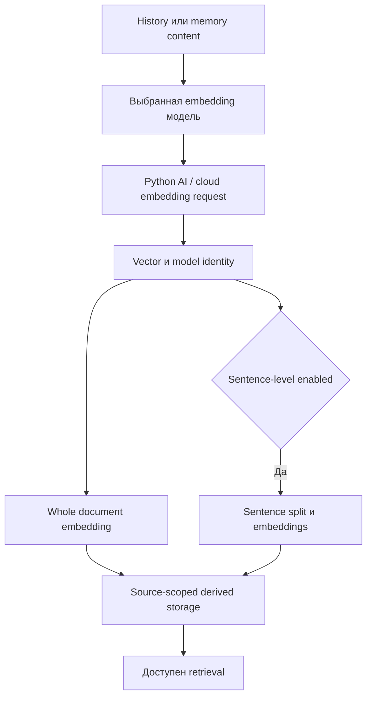

# RAG: границы поисковых корпусов, варианты извлечения и жизненный цикл индекса

**Статус:** подтверждённый статический функциональный аудит Python `CodeNow.zip`; основная возможность `CONDITIONAL` по настройкам, доступности SQLite/AI embedding service и выбранной модели. **Цель:** восстановить поведение и паритет для будущего Core 2.0, а не проектировать Rust-слои или исправлять старые алгоритмы.

## 1. Пользовательская функция

**CAP-RAG-INDEX-001 — восстановление подходящих воспоминаний и старых диалогов.** При генерации сообщения или явном поисковом вызове приложение собирает кандидатов из нескольких логических корпусов, присваивает оценку и возвращает обогащающий контекст. Отсутствие векторов **не означает** отсутствие текстовых данных: возможны FTS и отдельный keyword recall, если соответствующий retriever активирован. Подробные правила query construction/combination остаются в [rag.md](rag.md).

**CAP-RAG-INDEX-002 — фоновое создание производных поисковых данных.** Для истории и памяти формируются whole-document embeddings; при настройке sentence-level также формируются отдельные vectors предложений; если включён vector-поиск графа, могут индексироваться названия graph entities. Функция индексации **не** является самой функцией генерации LLM-ответа.

**CAP-RAG-INDEX-003 — пользовательская переиндексация.** Можно восполнить отсутствующие vectors для текущей модели либо пересчитать все vectors корпуса. Обе операции имеют progress callback, применяют batching и могут быть прерваны запросом отмены через `TaskCancelledError`. Это разные пользовательские операции с различным scope и стоимостью.

### Источники и подтверждение

| Контракт | Source evidence |
|---|---|
| Режимы `memory_mode`, исключение `island:*`, guard deleted, schema-compatible forgotten | `src/managers/rag/pipeline/repositories/memory_repo.py:25-56,62-120,126-222,228-273` |
| История для поиска — `is_active=0`; активная история нужна отдельно для построения query | `src/managers/rag/pipeline/repositories/history_repo.py:40-76,82-163,169-197,203-289` |
| Whole-vector candidates, optional actor pass, sentence aggregation | `src/managers/rag/pipeline/retrievers/vector.py:40-70,77-252,258-315,435-487` |
| FTS с BM25 и metadata/embedding join | `src/managers/rag/pipeline/retrievers/fts.py:40-181` и оба repositories `fts_rows` |
| Keyword retrieval без legacy embedding | `src/managers/rag/pipeline/retrievers/keyword_only.py:33-128` и оба repositories `keyword_rows` |
| On-write memory / batch history embeddings | `src/managers/rag/rag_manager.py:641-775,776-820` |
| Sentence embeddings и graph entity embeddings | `src/managers/rag/rag_manager.py:480-639` |
| Missing-index и full-index команды | `src/managers/rag/rag_manager.py:1104-1260,1261-1395` |

## 2. Семантика корпусов и идентичности

| Корпус | Идентичность возвращаемого candidate | Search visibility | Производные таблицы |
|---|---|---|---|
| Диалоговая история | SQLite `history.id`, отдельно может присутствовать `message_id` | Archive/inactive `is_active=0`, текущий `character_id`, не удалённые записи, если есть `is_deleted` | `embeddings` с `source_table='history'`, `sentence_embeddings`, `history_fts` |
| Долговременная память | `memories.eternal_id` (не SQLite `memories.id`) | Текущий персонаж, `is_deleted=0`, не `island:*`; `active/forgotten/all` по настройке и наличию столбца | `embeddings` с `source_table='memories'`, `sentence_embeddings`, `memories_fts` |
| Активная история | Исторические rows с `is_active=1` | Не подаётся в обычный архивный recall; используется для контекстных ролей/имён и хвоста построения query | Не является отдельным FTS-корпусом |
| Граф знаний | ID graph entity / relation (определяется graph subsystem) | Включение graph retriever, поиск по сущностям, relations и optionally vectors | Хранилище графа + embedding для entities |

`memory_mode='forgotten'` при отсутствии `is_forgotten` не возвращает memory rows; при `active` используется `is_forgotten=0`, при `all` не добавляется фильтр забывания. `island:*` исключён из стандартного retrieval, потому что эти записи имеют отдельную функцию в промпте. Для history retriever читает `speaker`, `target`, `participants`, `entities` только если соответствующие schema columns существуют.

**Существенное различие:** идентификатор пользовательского сообщения (`message_id`) и SQL-идентификатор строки истории (`id`) не взаимозаменяемы. Аналогично storage row `memories.id` и постоянный `eternal_id` имеют разные назначения. Новый Core должен сохранить функциональную идентичность ссылок, но структура его таблиц заранее не выбрана.

## 3. Извлечение кандидатов

1. **Vector whole-document:** запрос превращается в embedding. При `HAS_FAISS` вызывается кэшированный exact `IndexFlatIP`, максимум 500 hits на источник; по ID подтягивается актуальная SQL-метаинформация. Если FAISS-путь не дал hits, используется сканирование embeddings BLOB. Нормализация и проверка численных векторов входят в выборку кандидатов (`vector.py:77-191,258-375`, `faiss_index.py:112-226`).
2. **Vector sentence-level:** `sentence_embeddings` содержат `sentence_idx`, `source_table`, `source_id`, `character_id`, `model_name`; по каждому source оставляется лучший score предложения, а `matched_sentence` сохраняется в debug provenance. Если предложений в корпусе нет, retriever возвращается к whole-document (`vector.py:193-252,373-433`).
3. **Actor pass:** для исторических сообщений c `speaker/target` в текущем контексте есть дополнительный проход по связанным actors, с тем же `history.id` и source metadata (`history_repo.py:169-197`, `vector.py:435-487`).
4. **FTS:** `memories_fts`/`history_fts` — самостоятельный retrieval по SQLite FTS5; `bm25` превращается в lexical score; при доступности vector в `embeddings` дополнительный sim может участвовать в features (`fts.py:40-181`).
5. **Keyword-only:** SQL LIKE выбирает записи с пустым legacy `embedding`, затем фильтрует по keyword score. Это **не полноценный поиск по всему корпусу**; FTS отвечает за более общий lexical recall (`keyword_only.py:33-128`, `memory_repo.py:228-273`, `history_repo.py:203-234`).
6. **Graph:** отдельная retrieval family, не тождественная embedding history/memory; описана в [knowledge-graph.md](knowledge-graph.md).

Выход для всех источников — Candidate с `source`, `id`, `content`, `meta`, набором `features` и иногда `debug`. При последующем объединении источников ключи source/id и признаки важны для происхождения показанного контекста; UI не обязан показывать SQL-таблицы.

## 4. Создание и обслуживание embedding

- При изменении memory `update_memory_embedding(eternal_id,text)` сохраняет vector в legacy столбец и в `embeddings` с composite identity `source_table/source_id/character_id/model_name`; sentence embeddings опциональны (`rag_manager.py:641-684`).
- История поддерживает batch `update_history_embeddings(items, priority='bulk')`: удаляет пустые записи из запроса, сопоставляет полученные vectors с входами, сохраняет в одной последовательности writes и commit, считает реально сохранённые results (`rag_manager.py:686-775`). Есть и одиночный путь.
- `index_all_missing` выбирает записи, **для которых нет embedding текущей модели**, вне зависимости от наличия вектора другой модели; отдельно, по настройке, дозаполняет sentence vectors и graph-entity vectors; явное инвалидирование FAISS-кэша после индексации (`rag_manager.py:1104-1260`).
- `index_all` пересчитывает whole-document embeddings для всех подходящих history/memory records; по исходнику это не синоним `index_all_missing`: он не ставит фильтр `e.id IS NULL`, пишет batch-ами, делает per-batch `commit` и отдаёт прогресс (`rag_manager.py:1261-1395`).
- Sentence split отбрасывает короткие предложения по `RAG_SENTENCE_MIN_LEN`; исходные индексы предложений сохраняются в `sentence_idx`. Graph indexing запрашивает entities без векторов и индексирует **имена сущностей** (`rag_manager.py:480-639`).
- Переиндексация допускает `allow_when_rag_disabled=True` при запросе vectors: выключенная автоматическая подстановка RAG в LLM не должна запрещать пользователю обслуживание индекса. Реальный backend warmup/availability остаётся отдельной предпосылкой (`rag_manager.py:1104-1202,1307-1352`).

## 5. Функциональные состояния и ожидаемые сценарии

| Сценарий | Наблюдаемое назначение | Что нужно проверять при паритете |
|---|---|---|
| Новый факт памяти | Сохранение текста, позднее поисковое обогащение | Искать именно по `eternal_id`, scoping к персонажу и модели |
| Старый диалог с метаданными актора | Semantic/lexical retrieval и attribution | `history.id`, `message_id`, `speaker/target/participants` |
| Отсутствует embedding service | Деградация к доступному lexical recall | Отличать недоступный vector от пустой БД |
| Обновилась модель эмбеддингов | Индекс новой `model_name`; старый остаётся отдельным набором | Данные двух моделей не смешиваются |
| Дозаполнение vs rebuild | Missing rows или повторная генерация всех | Разная стоимость, progress, cancellation и итоговый count |
| Sentence-level включён | Лучшая семантическая близость одного предложения | Attribution `matched_sentence`, whole-doc fallback |
| Поиск forgotten | Выделенная область забытых фактов | `active/forgotten/all`, schema gating |
| Изолированные острова памяти | Always-on prompt вместо RAG поиска | Не возвращать islands как обычный recall |

## Требования для проверяемого функционального паритета

- `REQ-RAG-INDEX-001`: хранить и возвращать происхождение кандидатов с корректным стабильным identity истории/памяти и с фильтрами выбранного персонажа, архива, forgotten/island.
- `REQ-RAG-INDEX-002`: предоставлять настроенные lexical, vector, sentence и graph retrieval families; отсутствие модели или vectors не означает отсутствия текста в поисковом корпусе.
- `REQ-RAG-INDEX-003`: поддерживать отдельные операции дозаполнения и полного пересчёта индекса для выбранной модели с прогрессом, отменой и модельной изоляцией.

## 6. Границы, не подтверждённые этим проходом

Тесты реальных embedding models/FAISS, выбранных пользовательских presets, корректность полноты FTS rebuild, latency и сериализация между процессами здесь **не выполнялись**. Существующие предостережения о согласованности derived data описаны в иных документах; **не** выполнялся отдельный поиск багов или разработка исправлений. Это исследование нынешней функции, а не фиксация целевой технологии хранения.

Связанные материалы: [rag.md](rag.md), [language-normalization-rag-morphology-and-speech-numerals.md](language-normalization-rag-morphology-and-speech-numerals.md), [installable-catalog-and-runtime-readiness-matrix.md](installable-catalog-and-runtime-readiness-matrix.md), [RAG настройка в UI](../02-ui/rag-pipeline-and-embedding-provider-user-workflows.md).
