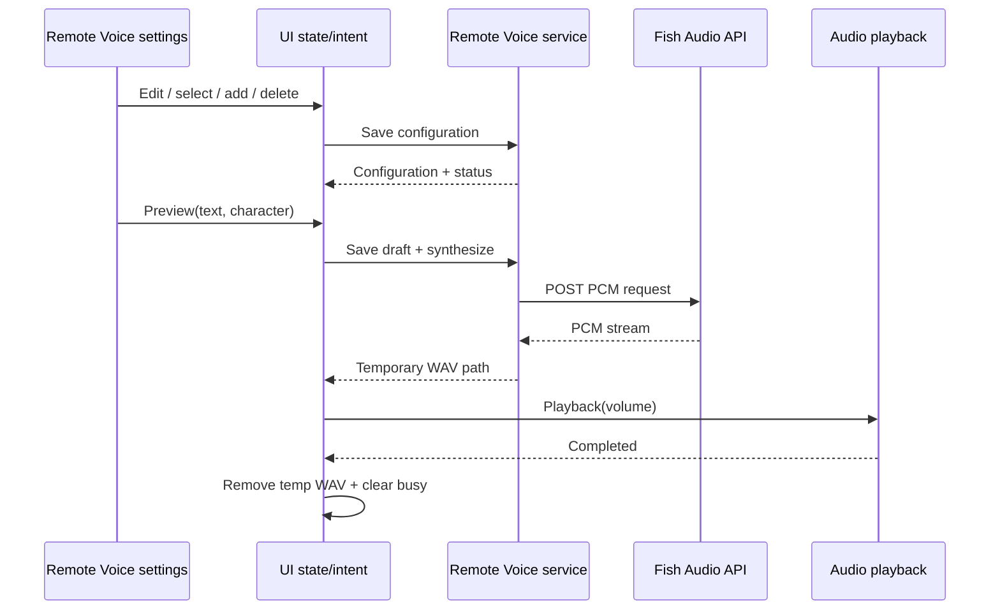

# Облачная озвучка: профили, голоса персонажей, preview и доставка аудио

**Capability:** `CAP-REMOTE-VOICE-001`—`005`; **статус:** `CONDITIONAL` (требуется provider configuration и сеть). **Источник:** `src/core/remote_voice.py:6-68`, `src/services/remote_voice_repository.py:17-104`, `src/services/remote_voice_service.py:28-342`, `src/handlers/remote_voice/fish_audio.py:22-218`, `src/controllers/gui/remote_voice_settings_view_model.py:31-163`, `src/ui/settings/voiceover_settings/remote_presentation.py:21-58`, `src/controllers/gui/voiceover_settings_view_model.py:57-84`.

## Возможности пользователя

- Создание нескольких независимых облачных TTS-профилей по provider template; переименование, изменение API key/model/speed/base voice, добавление и удаление. Активным одновременно является **один** preset; нельзя удалить последний.
- Прикрепление собственного `voice_id` к конкретному `character_id`, с необязательным отображаемым именем. Для персонажа без override используется default voice preset-а. Character identity здесь должна быть стабильной, а не текстом отображаемого имени (`core/remote_voice.py:18-54`).
- Переключение активного preset и отдельная проверка (preview) с выбранным текстом и персонажем. GUI сохраняет черновик перед select/add/preview, показывает busy/result/error; во время одной операции следующая блокируется (`remote_voice_settings_view_model.py:48-143`).
- Синтез в облаке и получение временного WAV-файла. Preview проигрывается локально с пользовательской громкостью в диапазоне 0–200, отправляет UI индикатор speaking, а временный файл удаляется по завершении, включая ошибку (`remote_voice_settings_view_model.py:145-163`). Это отдельный playback сценарий, не TTS model installation.

## Состояние, хранение, жизненный цикл

`RemoteVoiceConfiguration(active_id, presets)` — immutable read snapshot. Каждый `RemoteVoicePreset` содержит `id`, `name`, `template_id`, API key, default `voice_id`, model, speed, character overrides и voice display name. Default при отсутствии файла — один `fish_audio_default` preset. Repository поддерживает JSON версии 1,2,3, записывает текущую v3 в `settings_path('remote_voice.json')` через временный файл с flush/fsync и `os.replace` (`remote_voice_repository.py:17-104`). API key в этой реализации является полем JSON preset — **не** DPAPI account и **не** dedicated vault; новая реализация должна учитывать импорт старых данных, но целевая форма secrets пока не выбирается.

`DefaultRemoteVoiceService` создаёт общий managed HTTP client (45s overall/connect 15s и без redirects), нормализует config, поддерживает active preset и transient `verified` state. `configured` значит заполнены требуемые поля, `verified` в текущем процессе появляется после успешного synthesize, а не просто после редактирования (`remote_voice_service.py:28-69,134-164,233-250,252-316`). При изменении credential/voice readiness cached verification пересчитывается. Ошибка synthesis удаляет подтверждение.

`add_preset(template)` создаёт уникальный UUID и имя с числовым суффиксом при совпадении; новый preset становится активным (`remote_voice_service.py:195-218`). `delete_preset` не допускает пустого каталога; если удалён активный preset, активируется первый оставшийся (`:220-231`). Смена/редактирование требует существующего ID; duplicate character overrides и некорректные параметры отвергаются при нормализации (`:69-132`).

## Фактический облачный transport (Fish Audio)

`FishAudioProvider.normalize` принимает строго 32 hex-символа voice ID или HTTPS URL `fish.audio` / `www.fish.audio`, из которого выделяет ID. Скорость ограничена `0.5..2.0`; key должен содержать печатные ASCII символы; для готового запроса нужны и key, и voice (`fish_audio.py:57-114`). Отправляется POST в endpoint выбранного provider template с `Authorization: Bearer …`, header `model`, JSON `text`, `reference_id`, `format=pcm`, `sample_rate=44100`, `prosody.speed`, `normalize_loudness=true` (`:116-143`).

Сервис ожидает поток байтов PCM mono 16-bit/44.1 kHz и самостоятельно добавляет WAV container в `MitaVoices/remote_voice_*.wav`. Он не декодирует произвольный формат ответа. Поток читается частями и проверяется: HTTP status; не JSON/text вместо аудио; предел 100 MiB; общее wall-time 180s; чётное число PCM байтов; непустой результат; cancellation token (`fish_audio.py:144-217`). HTTP 401/403/404/422/429 и 402/insufficient-balance дают отдельные категории ошибки, а не общее `false`. Сетевых запросов в этом аудите не выполнялось; формат подтверждён статически, актуальность внешнего сервиса неизвестна.

Synthesize — асинхронный интерфейс над блокирующим запросом в рабочем потоке. При отмене asyncio выставляется threading `Event`, а поздно завершившийся temporary file удаляется callback-ом (`remote_voice_service.py:318-335`). При закрытии сервиса все активные cancellation events устанавливаются и HTTP client закрывается (`:337-342`). Важно сохранить lifetime файлов и передачу playback/Unity consumer, а не конкретную Python реализацию threading/asyncio.

## UI → Core сценарий

События Voiceover Settings отдельно умеют запросить запуск Telegram-Silero (при полной конфигурации Telegram), restart TTS AI service, открыть AI Hub прямо в TTS category/component, перейти в AI Engine settings (`voiceover_settings_view_model.py:57-84`). Эти действия не являются subtypes remote-voice preset CRUD.

## Требования для будущего Rust Core

Сохраняются пользовательские сценарии multi-presets + per-character voices, форматы импорта старых JSON, нормализация параметров/voice URL, редактирование без фоновой установки модели, preview с управляемой громкостью и cleanup, observability статуса configured/verified, возможность отмены сетевого получения, отдельное решение о маршруте результата в Unity/local audio. Core должен хранить ключи согласно выбранной после аудита privacy policy, не наследуя plaintext JSON автоматически.

**Не доказано:** работа endpoint при текущих внешних API; реальная доставка каждого облачного голоса в Unity; соответствие semantics других voice API templates (в registry текущего snapshot `DefaultRemoteVoiceService._providers` подтверждён `fish_audio`, остальные не приписывать без factory evidence). **Validation:** import v1/v2/v3, add/select/delete, duplicate overrides, per-character fallback, invalid voice URL, HTTP status classification, cancellation+temp cleanup, preview state, close during request.
