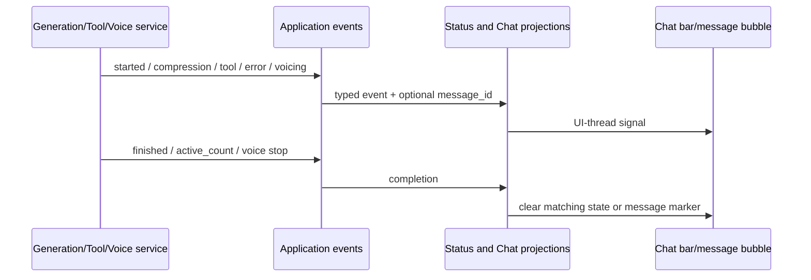

# GUI: состояния генерации, ошибок и озвучивания — сквозной функциональный контракт

**Статус:** `ACTIVE` для отображения основного чата; события зависят от ongoing generation, compression, selected tools и TTS. **Источник:** `src/controllers/gui/status_controller.py:17-205`, `src/ui/windows/app_window_base.py:58-94,201-224,1335-1412`, `src/ui/widgets/mita_status_widget.py:21-240`, `src/ui/widgets/status_indicators_widget.py:10-120`.

## CAP-UI-STATUS-001 — один чат, несколько независимых фоновых операций

| Событие / источник | Пользователь видит | Что завершает и что *не* завершает |
|---|---|---|
| `ON_STARTED_RESPONSE_GENERATION` → StatusController | «Персонаж думает…», аватар, анимированные точки | При наличии GenerationActivityService устаревшее событие игнорируется, если active count=0 (`status_controller.py:107-120`); отдельный watchdog для generation не используется (`mita_status_widget.py:51-98`) |
| `ON_COMPRESSION_STARTED` | Фоновое «Сжатие истории…» с пиктограммой | `ON_COMPRESSION_FINISHED` убирает **только** compression/status и не должен перекрывать текущую генерацию (`status_controller.py:122-146`; `mita_status_widget.py:119-126`) |
| `ON_TOOL_EXECUTING` | Статус `Tool: <name>` | Не доказательство завершённости инструмента; result обрабатывается в основном dialogue pipeline (`status_controller.py:152-159`) |
| `ON_SUCCESSFUL_RESPONSE`, `GENERATION_ACTIVITY_CHANGED(active_count=0)` | Убирается отображение генерации | Важно число *оставшихся* активных генераций, а не одиночный successful event (`status_controller.py:130-140`; `mita_status_widget.py:128-132`) |
| `ON_FAILED_RESPONSE_ATTEMPT` | Запрос индикации кратковременной ошибки | `pulse_error_animation()` в текущем виджете является no-op; это не отдельное терминальное состояние (`mita_status_widget.py:167-169`) |
| `ON_FAILED_RESPONSE` | Терминальная ошибочная строка с закрытием пользователем | Новый start turn снимает старую ошибку; фоновый compression/tool статус не перезаписывает её (`mita_status_widget.py:54-64,82-99,140-161`) |
| `SHOW_MITA_VOICING` / `HIDE_MITA_VOICING` | Подсветка **конкретного пузыря сообщения**, если есть `message_id` | В текущем AppWindowBase это не глобальная строка voicing: `set_message_voicing(id,true)` и `clear_message_voicing()` (`app_window_base.py:1392-1408`) |

События ошибочной генерации дополнительно несут `provider_error`/`message_id`/`character_id`. При наличии message ID ошибка отмечается на конкретной пользовательской реплике через chat presentation/renderer, независимо от общего status banner (`app_window_base.py:1340-1361`). Отдельное событие `clear_chat_message_error` очищает соответствующую запись по identity, не весь чат (`:1363-1377`).

## CAP-UI-STATUS-002 — политики отображения и времени

`MitaStatusWidget` — совместимый bridge на typing bar в ChatWidget: сам вспомогательный QWidget скрыт, а видимое состояние принадлежит встроенной chat status bar (`mita_status_widget.py:1-47`). Его `current_state` включает `idle`, `thinking`, `status`, `compression`, `voicing`, `error`, `success`. Для фонового статуса/озвучивания используется защитный watchdog **240 секунд** (`:16-19,186-204`); generation имеет backend-owned lifecycle и не сбрасывается этим таймером. Отображаемая локализация `RU/EN` берётся из текущих UI strings; конкретный виджет не является владельцем runtime operation.

Сетевые и timeout provider errors дублируются как системное событие чата (при соответствующих `provider_error.code`), с 2-секундной дедупликацией одинакового текста (`status_controller.py:160-195`). Показ generic error после недавнего detailed provider error может подавляться во избежание дублирования. В документации важно различить **transport failure**, **UI status**, **failed message projection** и **user-visible chat event**.

`StatusIndicatorChip` — другая функциональность: шесть независимых read-only индикаторов `Game/Voice/RAG/Recognition/Screen/Camera`, создаваемых как chips, не кнопки управления (`status_indicators_widget.py:10-49,84-120`). Screen/Camera visibility определяется доступностью settings-section `screen`, а не флагом фактического захвата (`:52-68`). Эти chips отображают состояние сервисов, но не заменяют activity banner диалога.

## Данные, ownership и переходы

Значимые инварианты поведения: позднее завершение compression не должно выключать новое thinking; ошибка не должна исчезать из-за фонового статуса; завершение одного из нескольких turns не выключает общую активность; voicing привязывается к сообщению; message-level failure привязывается к устойчивому message ID и character ID.

## Требования и пределы

- `REQ-UI-STATUS-001`: представлять generation, compression, tool execution, speaking и errors как разные основания/владельцы статуса, не как единый бесконтрольный текст.
- `REQ-UI-STATUS-002`: correlation до `message_id`, `character_id` и generation activity count там, где это требуется; поздний event не должен стирать более новое состояние.
- `REQ-UI-STATUS-003`: обеспечить не только status text, но и per-message failure и per-message voicing marker.
- `REQ-UI-STATUS-004`: отличать read-only service status chips от команд включить/выключить соответствующий сервис.

**Не проверено:** фактическое поведение в живом Qt при нескольких одновременных turn-ах, реальный TTS playback, вызов ошибок remote provider, эффект старых style sheets; это статический контракт. Старые no-op animation методы зафиксированы как необязательные presentation details, не как повод исследовать баги.
