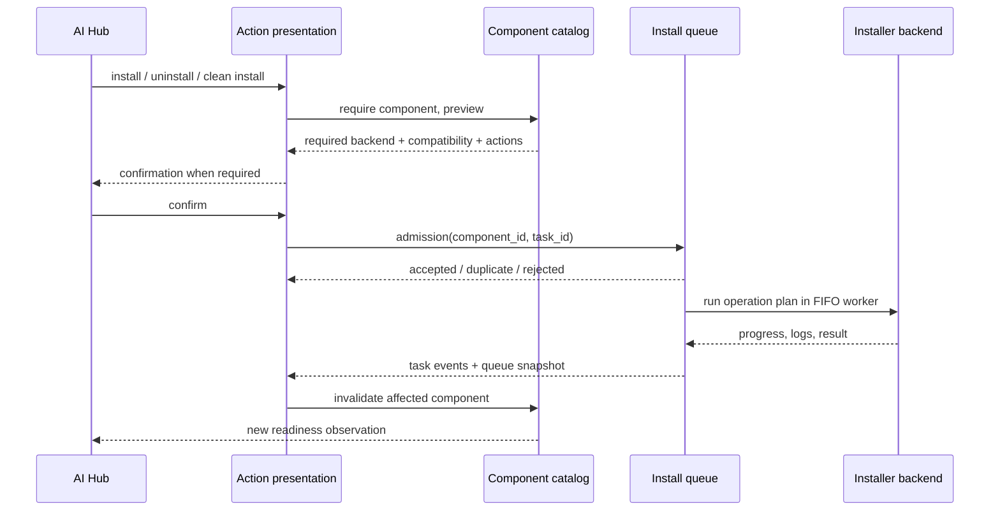

# Установка AI-компонента: admission, очередь, выполнение и подтверждение результата

**Scope:** действующий Python Core/GUI control plane; Python AI inference остаётся самостоятельным. **Статус:** `ACTIVE` как application capability, конкретный компонент `CONDITIONAL`. **Источник:** `src/controllers/installable_controller.py`, `src/controllers/gui/install_gui_controller.py`, `src/controllers/gui/ai_hub_view_model.py`, `src/services/installable_catalog_service.py`.

## CAP-INSTALL-QUEUE-001 — пользовательский intent ≠ установленный компонент

Полный маршрут:

`src/controllers/gui/ai_hub_view_model.py:171-249`: запрос устанавливает bootstrap readiness (backend, optional installables) и для install запрашивает preview; дополнительный backend требует отдельного пользовательского подтверждения. `submit_component_action()` передаёт `component_id`, `task_id`, source `ai_hub`, callbacks и окно логов (`:251-298`). **Accepted** означает, что очередь приняла действие, а **duplicate** — что аналогичный `task_id` уже выполняется/ожидает; ни то ни другое не означает успешной установки.

`src/controllers/installable_controller.py:165-275`: controller по `component_id` строит lazy runner, который позже получает execution context от installer. `meta` содержит kind/category/component/item/op/clean. Поддерживаются `install`, `uninstall`, `initialize`; `clean` отличается от обычного install. Фактический план составляется через catalog `build_operation_plan`, когда backend его выполняет. Наличие `with_ui=False` допускает headless operation, не требующую окна.

## CAP-INSTALL-QUEUE-002 — serial FIFO для конфликтующих операций

`src/controllers/gui/install_gui_controller.py:22-65,69-124`: единый worker и одна общая FIFO-очередь с `running`, `pending`, task ID и cancellation event. Дубликаты одного task ID распознаются среди running/pending. Queue может временно перестать принимать новые задачи при обслуживании AI environments (`:100-124,235-261`). Это функционально важнее конкретного класса: две установки не должны одновременно произвольно мутировать одну managed Python среду.

Ожидающая задача отменяется удалением из pending; выполняемая — установкой cancel event, который должен быть обработан шагами installer cooperative cancellation (`:131-168`). `quiesce` при обслуживании окружений останавливает admission, сбрасывает pending и просит текущую задачу завершиться, после чего ожидает максимум указанный timeout. `resume` восстанавливает admission (`:235-261`). Здесь не следует обещать instant kill внешнего pip/HF subprocess, если не подтверждён отдельный процессный stop.

`_run_job` создаёт диалог установки при **старте задачи**, не при enqueue, либо пользуется переданным встроенным UI/callbacks. Backend `run_task` получает deadline, cancel event, metadata и progress/log callbacks (`:287-344`). Если окно разделяется с ещё ожидающими задачами, оно сохраняется между ними; при неуспехе окно может остаться для чтения логов (`:364-392`). В headless-режиме callback окна нет (`:355-362`).

## CAP-INSTALL-QUEUE-003 — пользовательские стадии результата

| Стадия | Точный смысл | Evidence |
|---|---|---|
| Preparing backend | Проверяются controller/backend и план; ещё нет admission | `ai_hub_view_model.py:171-248` |
| Confirmation | Разрешение на required backend или конкретное действие | `ai_hub_view_model.py:227-240`; `ui/windows/ai_hub/dialog.py:1359-1423` |
| Queued / already queued | Admission result, возможен duplicate | `ai_hub_view_model.py:251-298`; `install_gui_controller.py:100-124` |
| Running | Единственная активная installer task | `install_gui_controller.py:287-344`; `ai_hub_view_model.py:418-463` |
| Cancel requested | На running установлен event, операция может ещё завершать текущий шаг | `install_gui_controller.py:147-168` |
| Finished / failed | Backend выдал исход операции, лог и event; это ещё не итоговый status probe | `install_gui_controller.py:335-392`; `ai_hub_view_model.py:465-519` |
| Rechecking | Invalidate ID и проверка `status.ready` в текущем runtime context | `ai_hub_view_model.py:465-526`; [status observation](installable-status-observation-and-invalidation.md) |

`src/ui/windows/ai_hub/dialog.py:1192-1225` блокирует mutation других карточек, пока очередь занята, но presentation слой может принять предварительный запрос/показать очередь через отдельный backend admission. Реальный install progress и readiness status UI не должны смешиваться.

## Requirements / будущие проверки

- `REQ-INSTALL-QUEUE-001`: приём задачи, дубликат, отказ, queued/running, отмена и завершение являются разными наблюдаемыми исходами.
- `REQ-INSTALL-QUEUE-002`: операции над общей AI environment должны иметь сериализацию и контроль остановки перед очисткой/переключением среды.
- `REQ-INSTALL-QUEUE-003`: `initialize`, `uninstall`, обычный `install`, `clean` должны оставаться различными пользовательскими командами/планами.
- `REQ-INSTALL-QUEUE-004`: после `TASK_FINISHED` подтвердить readiness отдельной проверкой, не присваивать `ready=true` только из task success.
- `REQ-INSTALL-QUEUE-005`: сохранить логи/прогресс и graceful lifecycle окна для очереди и headless сценария.

Validation: duplicate click, different component FIFO, cancel pending, cancel running, quiesce for environment repair, no GUI headless, shared log window, backend install confirmation, success-but-not-ready. В этом проходе не выполнялись установки, Qt E2E или сетевые downloads. **Ошибки текущего Python не расследовались.**
