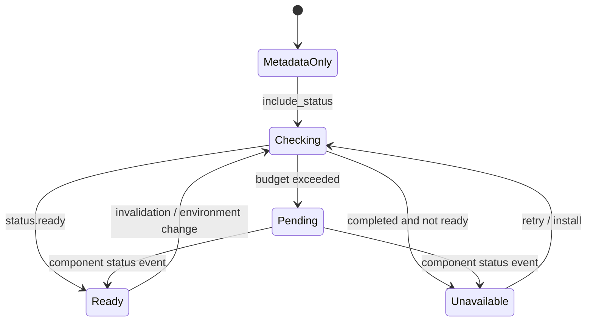

# Устанавливаемые компоненты: жизненный цикл проверки состояния и подписки

**Область:** AI Hub, installers, AI Engine readiness. **Статус:** `ACTIVE` каталог; индивидуальный probe `CONDITIONAL`. **Источники:** `src/services/installable_catalog_service.py`, `src/controllers/gui/ai_hub_view_model.py`, `src/core/events.py`; локальный Python snapshot, без реального запуска Windows GUI.

## CAP-INSTALL-OBS-001 — запрашиваемый snapshot и фоновая проверка

`DefaultInstallableCatalogService.list_rows(include_status, refresh, category, status_category)` разделяет список карточек и подмножество реально проверяемых категорий (`installable_catalog_service.py:206-236`). Это позволяет показать всю доступную metadata, не запуская проверку всех моделей. Служба имеет executor на четыре probe-задачи и отдельный executor для запросов, кеш статусов, in-flight futures и revision каждого компонента (`:39-84`).

Контекст проверки складывается из hardware inventory, voice language, ASR engine settings + revision и выбранной managed environment (`:825-868`). Его fingerprint SHA256 без transient полей становится частью ключа кеша `(component_id, context_fingerprint)` (`:870-878`). Следовательно, один `component_id` может иметь **разный readiness** после изменения окружения/настроек без смены самой карточки.

Функциональное разделение:

1. Нет `include_status`: возвращается metadata и compatibility, но не утверждается `ready`.
2. Есть кеш для текущего контекста: отдаётся сохранённый статус.
3. Нет кеша: запускается/разделяется текущий probe и ожидание до status budget (по умолчанию 15 s).
4. Проверка не успела: возвращается временный `unknown` с `probe_state=timeout/pending`, **не** `not installed`.
5. Status устарел из-за invalidate: временное `stale`, новый probe, старая revision не публикуется.
6. Поздно завершённый актуальный probe публикует `Events.Install.COMPONENT_STATUS` для конкретного component ID (`:616-709,774-819`).

## CAP-INSTALL-OBS-002 — видимые состояния и граница backend

`_inspect_component()` (`:880-889`) использует `component.status(ctx)` при доступном backend. Если env требуется, но недоступен, возвращается `backend_missing`; при этом `installed` может быть истинным: **наличие файлов модели** и **готовность запуска inference** различаются. Исключение probe → `failed`; `unknown` → временное состояние, а не отрицательный результат (`:891-924`). Точные предикаты для FFmpeg, voice assets, RAG и Beat описаны в [component probes](../01-functional/installable-component-probe-and-operation-contracts.md).

Сервис инвалидирует TTS-category при `VOICE_LANGUAGE`, а ASR-card при смене соответствующих engine settings; подписки закрываются при `close`, pending futures получают cancel request (`:88-124`). Инсталляционные started/finished/failed события тоже ведут к invalidate (`src/controllers/installable_controller.py:36-60`). Это **наблюдаемость изменений**, а не гарантированное мгновенное обновление всех реальных disk resources.

## CAP-INSTALL-OBS-003 — доставка снимка в UI

`AIHubViewModel.refresh` использует coalesced job и возврат `rows + hardware + timestamp` (`ai_hub_view_model.py:110-145`). Начальный metadata pass вызывает последующий status pass (`:300-338`). Если row имеет transient status, она попадает в `checking_component_ids`; дополнительное событие `INSTALL_COMPONENT_STATUS` заменяет только соответствующую строку, снимая checking (`:343-397`). Есть независимые UI budgets: timeout всего refresh и timeout ожидания transient status (`:353-416`). Эти таймауты разблокируют presentation, но не доказывают завершение всех внутренних probes.

После установки UI обновляет конкретный ID и выполняет новый status pass; queue/cancel/progress отражаются отдельно (`ai_hub_view_model.py:418-542`). `src/ui/windows/ai_hub/dialog.py:1170-1225` различает `checking`, `running`, `queued`, `global_busy`, `idle`. Не нужно считать загрузку сетки доказательством исправности Python AI worker.

## Обобщённая модель состояний для проектирования *после* аудита

Диаграмма показывает только пользовательски наблюдаемый смысл. Реальные `code`, `backend_ok`, `installed`, `details` и compatibility являются **ортогональными атрибутами**, а не единственным enum-состоянием.

## Требования и будущая проверка

- `REQ-INSTALL-OBS-001`: статус должен быть привязан к component ID + контексту проверки и revision, а не к одному глобальному булевому флагу.
- `REQ-INSTALL-OBS-002`: отличать timeout/pending/stale от доказанного `not ready`, иметь путь доставки позднего результата.
- `REQ-INSTALL-OBS-003`: изменения настроек, среды и установка дают reason для повторной проверки только затронутого компонента/группы.
- `REQ-INSTALL-OBS-004`: UI должен показывать очередь, ход операции и статус ресурса независимо; backend missing не означает отсутствие весов.

**Validation backlog:** повторный запрос одного ID объединяется с in-flight; context revision инвалидация; late delivery; cleanup on close; сначала metadata then status; changing voice language; ASR model settings; CPU/ONNX/CUDA compatibility. Сетевые/Windows/HF downloads не запускались. Проблемы старого кода специально не искались.
