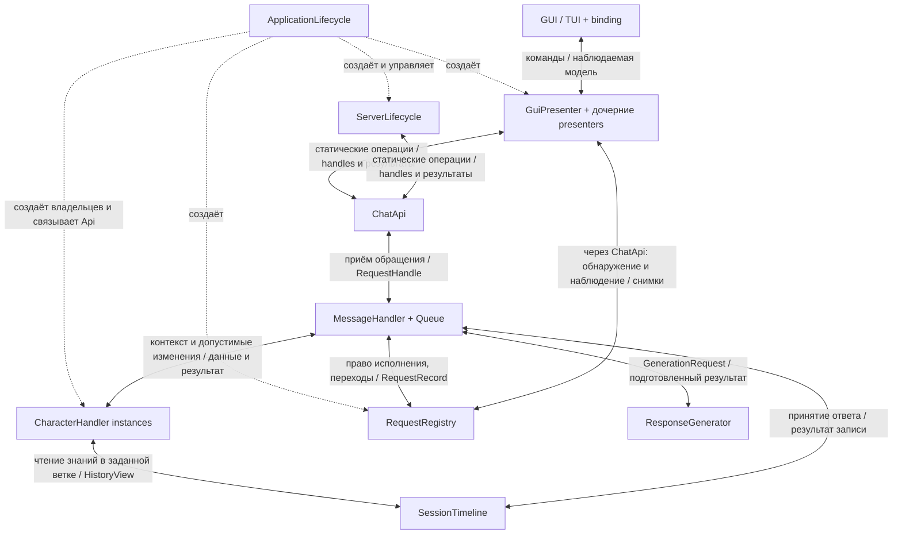

# Текущая модель нового ядра

Реализованное минимальное подмножество всех обсуждённых связей: [minimal-contracts.md](minimal-contracts.md). Точный статус проверок и передачи: [чеклист](implementation-checklist.md).

Обновлено 2026-10-31. [Навигация](README.md). Этот документ заменяет ранний эскиз с экземплярным ResponseService и ContextBuilder. Новая реализация проектируется с нуля.

Часть модели уже реализована: [первый срез](first-slice.md). Уточнение для него: пресет передаётся как типизированный GenerationPreset с провайдерским шаблоном; каталог PresetRef/revision пока не реализуется. Gemini — один из адаптеров общего контракта генерации.

## Основа

Приложение построено вокруг генерации сообщений персонажей. Персонаж предоставляет субъективный контекст: собственные описание и промпты, состояние, известные ему события и наблюдения.

Одно запущенное приложение имеет одно ядро, общий источник истории и общий учёт выполняемых обращений. Несколько персонажей, клиентов и конкурентных запросов обслуживаются этим ядром. Несколько независимых ядер внутри процесса не являются требованием.

События мира и изменения персонажей могут происходить самостоятельно, без обязательного запуска генерации.

## Статические Api

Согласовано: все типы с суффиксом Api являются статическими входами приложения. В Rust используется написание ChatApi, SettingsApi, а не ChatAPI.

ChatApi предоставляет reply/react/initiate; конкретный состав входных типов ещё уточняется. Вызовы направляются исполнителям, связанным с Api при запуске. До инициализации возвращается явная ошибка; поведение во время остановки также должно быть определено.

Presenter и ServerLifecycle могут вызывать ChatApi::reply(...) напрямую. Отдельный ChatCommands только ради скрытия конкретного ChatApi не требуется. Api не ищут зависимости в произвольном общем контейнере сервисов; их внутренний доступ связывается при инициализации.

Статический доступ не сериализует генерации. Операция отправки кратко принимает обращение и возвращает RequestHandle. Сетевого ожидания LLM внутри неё нет.

## Объекты и владельцы

| Объект | Ответственность и владение |
|---|---|
| ApplicationLifecycle | Сборка крупных частей приложения и управление их исполнением |
| ServerLifecycle | Сетевые ресурсы, соединения, команды протокола, передача результатов клиентам |
| ChatApi | Статический приём типизированных обращений |
| RequestRegistry | Активные RequestRecord, допустимые переходы, отмена и наблюдение |
| MessageHandler | Очередь и последовательное исполнение принятых обращений |
| CharacterRegistry | Map CharacterId → CharacterHandle с явно заданным составом |
| CharacterHandler | Исключительное владение живым Character, изменения его состояния, субъективный контекст |
| Character | Неизменяемые описание/собственные промпты и изменяемое состояние |
| SessionTimeline | Канонические смысловые факты сессии, ветки, причинность и основа знаний персонажа |
| ResponseGenerator | Исполнение генерации и предусмотренная пресетом подготовка провайдерского запроса |
| Presenter и дочерние presenters | Пользовательские команды, наблюдаемая модель взаимодействия с приложением |
| UI binding | Связь конкретных элементов GUI/TUI с контрактами presenter |

Названия ApplicationLifecycle, ResponseGenerator и внутреннего исполнителя принятия являются проектными. Точные Rust-модули и все типы ещё не реализованы.

## Система связей

Линия принятия ответа обозначает обязанность, которую ещё надо конкретизировать отдельным контрактом. Она не разрешает независимую запись в timeline в обход согласования с владельцем персонажа.

## Персонаж и контекст

Фиксированный набор персонажей создаётся явно в коде. CharacterRegistry предоставляет handle владельца; не выдаёт произвольную изменяемую ссылку на Character.

CharacterHandler изменяет state через типизированные операции и предоставляет согласованный CharacterContext. Собственные описание и промпты персонажа неизменяемы через доступный API.

HistoryView строится из SessionTimeline для персонажа, ветки и границы событий. Дополнительная постоянная каноническая история внутри Character не требуется. Кеши возможны как производные данные.

Вызов наподобие get_context(at) отражает эту обязанность. Точный тип позиции и согласование исторической границы с mutable состоянием оставлены для следующей детализации.

MessageHandler и CharacterHandler пока разделены: ожидание LLM не должно блокировать короткие изменения состояния персонажа. Один handler на персонажа/область сессии — текущая рекомендация; окончательный ключ очереди ещё не утверждён.

## Пресет и генерация

Обращение явно задаёт персонажа, вход и PresetRef. Отсутствующий обязательный вход и неразрешимая ссылка дают ошибку. Автоматический выбор первого, текущего или запасного пресета запрещён.

Предложена ссылка на конкретную revision пресета. Точная форма идентификаторов и этап разрешения ссылки ещё уточняются.

Базовый вход генератора: GenerationRequest с CharacterContext и ResolvedPreset. Пресет может задавать протокол, провайдера, преобразования, обработчики и параметры генерации.

Модуль генерации выполняет нужную подготовку, кодирование провайдерского запроса и разбор результата. Отдельный Composer-сервис не требуется. Чистые функции сборки могут существовать внутри модуля. Новые промежуточные типы вводятся по различию данных и гарантий, а не для перекладывания полей.

Все включаемые сведения о мире должны соответствовать знаниям персонажа. Производные summaries и retrieval также подчиняются этому правилу.

## Запрос и принятие результата

Принятое обращение сразу имеет идентичность и средства отмены, даже пока оно в очереди. Рекомендуемое имя доменного типа — RequestId; UUID предложен как представление, версия ещё не выбрана.

Публичная модель состояния: Pending, Processing с этапом, Finished с типизированным исходом, Cancelled. Итог различает успех, ошибку текста, ошибку озвучки с обязательным текстом и внутреннюю ошибку с доступными частичными результатами.

ResponseEffect описывает подготовленные изменения. До принятия они не меняют персонажа. Внутренний enum фазы пакета: Working, Accepting, Applied, Discarded. Отмена и начало Accepting согласуются атомарно. Finished подтверждает завершённое принятие; следующий запрос персонажа начинается после него.

Ошибка применения, восстановление и согласованность timeline/Character требуют отдельного контракта. Четыре перечисленных варианта фазы сами по себе его не реализуют.

## Наблюдение

RequestHandle позволяет читать состояние, наблюдать его, запросить отмену и получить итог. Ожидание обновлений асинхронное, без периодического опроса; GUI не блокируется.

Наблюдается согласованный снимок с RequestId, revision и RequestState. Состояние содержит относящиеся к нему данные. Поздний наблюдатель получает актуальный снимок. Предложена семантика последнего состояния с возможным объединением промежуточных обновлений.

GUI также обнаруживает обращения, отправленные сервером и другими источниками: согласованный начальный список активных запросов плюс поток новых принятых обращений. Этот поток не заменяется одним watch последнего созданного запроса.

## Настройки и presenter

Настройки представлены структурами разделов с bool, числами, строками, вложенными структурами и enum только для конечных вариантов. Не утверждён каталог из 500 отдельных типов ключей.

Статический SettingsApi предоставляет доступ к владельцу настроек. Изменения проверяются, публикуются и сохраняются; принятие настройки, запись на диск и применение исполнителем различаются.

Presenter — самостоятельная часть приложения, предоставляющая UI команды и наблюдаемые модели. GuiPresenter может собирать ChatPresenter, SettingsPresenter и другие функциональные части. Его не создаёт и не реализует конкретный виджет.

Для параметров рекомендованы типизированные bindable-свойства presenter: получить значение, запросить изменение, наблюдать изменения. Для действий — команды. UI не получает произвольный mutable-доступ к хранилищу.

## Владение и уровень готовности

Arc не обязателен для каждой зависимости. Владение ресурсами, каналы, заимствование и совместное владение выбираются по срокам жизни и требованиям исполнения. Локальные ссылки из ранних примеров не являются готовым решением для GUI callbacks или фоновых задач.

Иерархическая сборка распределена по модулям: каждый владелец создаёт внутренние части и получает внешние зависимости. Один bootstrap, конструирующий вручную все объекты приложения, не является целью.

Полная модель ещё не реализована. Открытые вопросы перечислены в тематических документах, фактическое состояние Cargo-проекта — в [первом срезе](first-slice.md).
